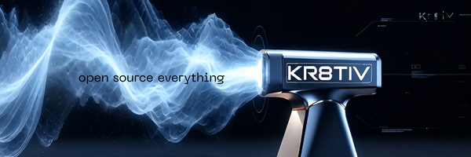

<div align="center">



<br />

### Decentralized AI for the Masses

*Powerful. Practical. Dangerous (in a good way).*

---

[](https://www.kr8tiv.ai)
[](https://x.com/kr8tivai)
[](https://bags.fm)

---

</div>

## What We Build

We build **open-source AI products**, **Operational Automation tools**, and **DeFi infrastructure** — pushing the boundaries of what autonomous systems can achieve.

From managing a local construction crew with a business OS, to AI companions and automated trading bots, our mission is to build AI that actually does the work.

---

## Evolved & Operations

> *Building Businesses That Run Themselves*

Automating operations so you can focus on the important stuff.

| Core Component | What It Does | Repo |
|---|---|---|
| 🧠 **Evolved Core (MCP)** | The brain of the operation. A free & open-source Model Context Protocol server exposing 84 specialized tools to LLMs for completely autonomous business management. | [`evolved`](https://github.com/kr8tiv-ai/evolved) |
| 📊 **Ops Workbook Router** | The database and truth-source. A 20-tab operational spreadsheet backed by a custom Google Apps Script router for real-time syncing. | [`evolve-ops-workbook`](https://github.com/kr8tiv-ai/evolve-ops-workbook) |
| 📈 **Owner Dashboard** | High-level analytics, financial tracking, and job scheduling. Built for the business owner to monitor the AI's operations. | [`evolve-dashboard`](https://github.com/kr8tiv-ai/evolve-dashboard) |
| 📱 **Field App** | The crew's on-site interface. Job details, photo uploads, and time-tracking, synced directly back to the Ops Workbook and MCP. | [`evolve-field-app`](https://github.com/kr8tiv-ai/evolve-field-app) |
| 🏡 **Aura Homes OS** | A specialized fork/implementation of Evolved designed specifically for sustainable, local-first eco-home construction. | [`aura-homes`](https://github.com/kr8tiv-ai/aura-homes) |
| 🤵 **Jarvis** | Autonomous AI trading bot and digital assistant for continuous market awareness. | [`Jarvis`](https://github.com/kr8tiv-ai/Jarvis) |
| 🧠 **GSD-2** | Meta-prompting and spec-driven development system for orchestrating these long-running autonomous agents. | [`gsd-2`](https://github.com/kr8tiv-ai/gsd-2) |

---

## KIN — AI Companions

> *We Build You A Friend*

The flagship AI companion platform. 57 unique 3D characters across 6 bloodlines, each powered by a different frontier AI model. Soul authoring, skill portability, NFT ownership on Solana.

| | |
|---|---|
| **[Kin](https://github.com/kr8tiv-ai/Kin)** | Core platform — Next.js 15, Fastify 5, multi-brain inference, 200+ tests |
| **[Runtime Truth Contracts](https://github.com/kr8tiv-ai/kr8tiv-runtime-truth-contracts)** | Schema-first runtime contracts for AI agent governance |
| **[Mission Control](https://github.com/kr8tiv-ai/kr8tiv-mission-control)** | AI agent governance dashboard with Task Mode |
| **[kr8tiv-MSW](https://github.com/kr8tiv-ai/kr8tiv-MSW)** | Multi-service worker orchestration |

---

## PinkBrain — DeFi x AI on Bags.fm

> *Powered by $BRAIN*

The **Pinky and the Brain** ecosystem — DeFi infrastructure that converts on-chain activity into AI capabilities and yield for $BRAIN holders.

| | |
|---|---|
| **[PinkBrain Router](https://github.com/kr8tiv-ai/PinkBrain-Router)** | Converts Bags.fm DeFi fees into OpenRouter API credits for 300+ AI models |
| **[PinkBrain LP](https://github.com/kr8tiv-ai/PinkBrain-lp)** | Auto-compounding Meteora DAMM v2 liquidity engine |
| **[PinkBrain Alvara](https://github.com/kr8tiv-ai/PinkBrain-Alvara)** | ERC-7621 basket token infrastructure on Base |
| **[DLMM Staking](https://github.com/kr8tiv-ai/DLMM-auto-sell-assets-into-staking-contract)** | Automated DLMM position manager with validator staking |

---

## Bags.fm Hackathon Submissions

| | |
|---|---|
| **[Travelswap](https://github.com/kr8tiv-ai/kr8tiv-Travelswap-on-Bags-App)** | Travel booking on Bags.fm |

---

## Tech Stack

```
TypeScript  ·  Next.js 15  ·  React 19  ·  Fastify 5  ·  Viem  ·  Three.js
Solana Web3.js  ·  Metaplex  ·  Meteora  ·  Ollama  ·  Docker  ·  Vitest
```

---

<div align="center">

**[kr8tiv.ai](https://www.kr8tiv.ai)** · **[@kr8tivai](https://x.com/kr8tivai)** · **[Bags.fm](https://bags.fm)**

Built by [Matt Haynes](https://github.com/Matt-Aurora-Ventures)

</div>
